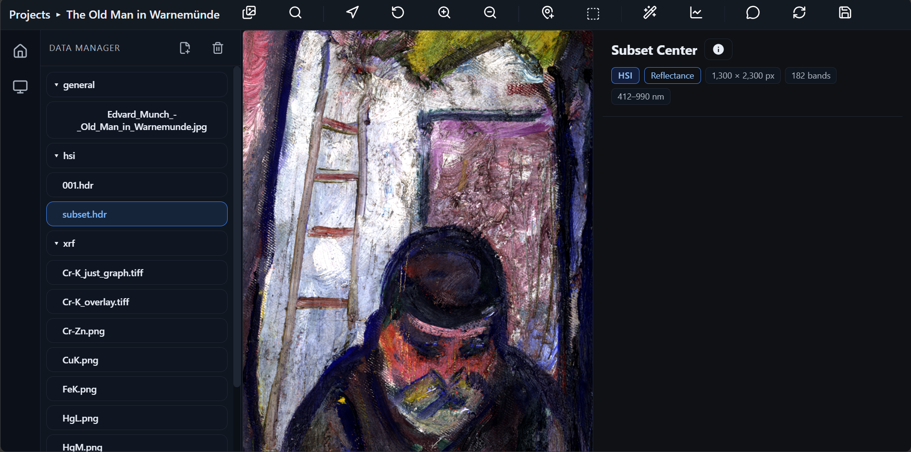
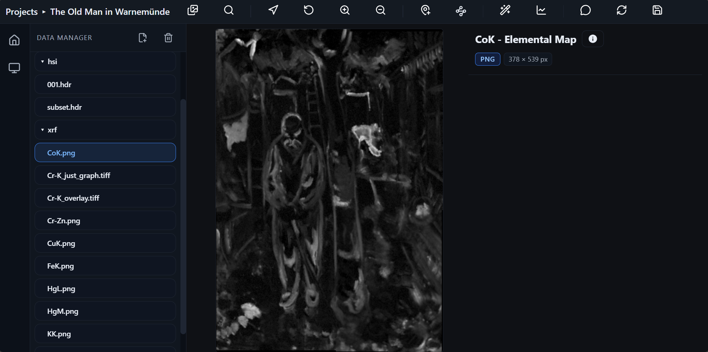
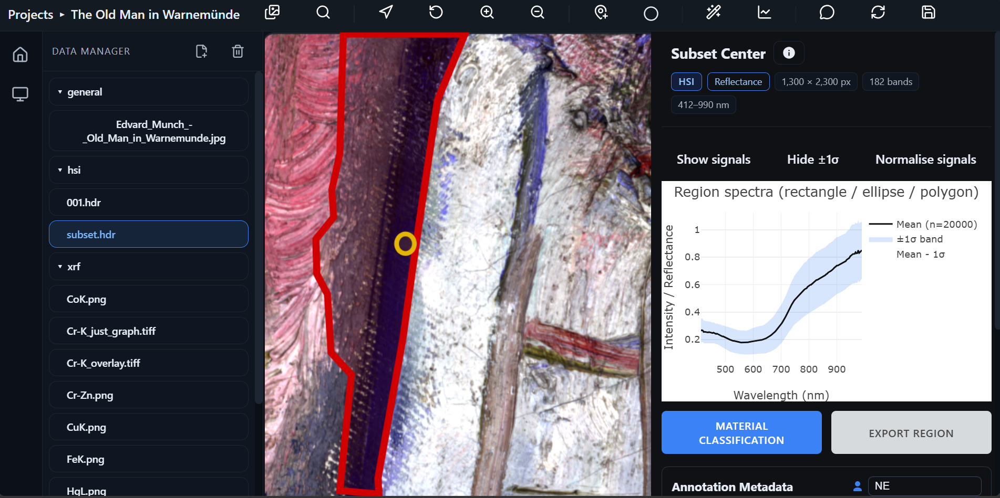
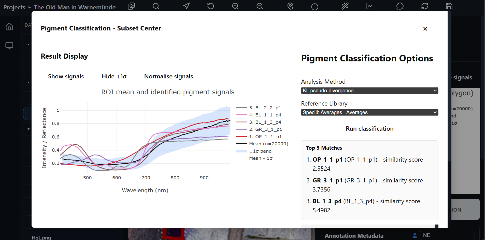
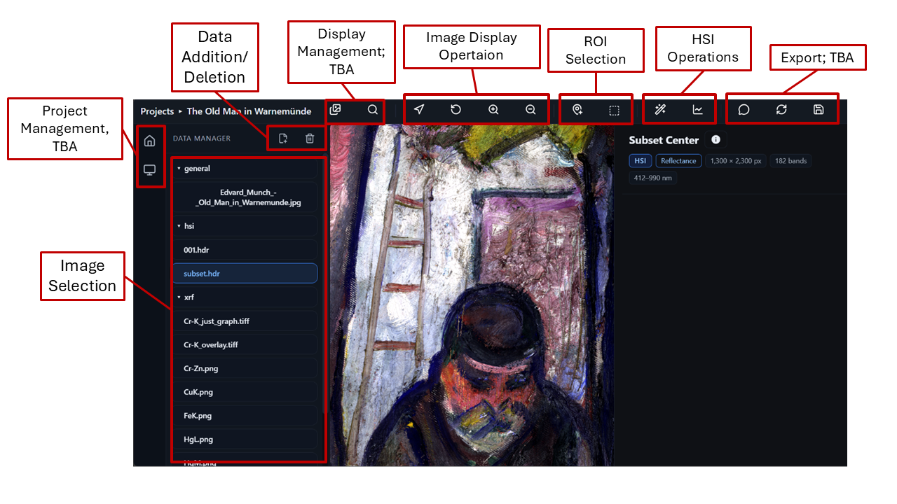

# SpectraPaint

A web application for viewing and analysing hyperspectral image (HSI) data of
paintings together with complementary modalities such as macro X-ray
fluorescence (MA-XRF) and RGB photography. SpectraPaint supports image display
and annotation, spectral plotting, region-of-interest selection, and
pigment/material classification for cultural-heritage imaging.

## Quick start

SpectraPaint runs on your own machine: one instance, your own data, its own SQLite
database created automatically on first run. There is no server and no account.

Choose whichever route suits you — [INSTALL.md](INSTALL.md) covers all three in
full, including a prebuilt Windows installer that needs no command line at all.

### With Docker — nothing to install but Docker

```bash
docker compose up --build
```

Then open <http://localhost:8756>. The image already contains Python, the built
interface and every dependency, so there is no virtual environment to create and
no Node to install. `docker compose down` stops it and keeps your data; see
[INSTALL.md](INSTALL.md#b-docker) for where it is kept and how to back it up.

### From source — for development

Needs **Node.js 22+** (includes npm) and **Python 3.12+**.

```bash
cd frontend
npm install
npm run build     # production build, used by the packaged app
# or: npm run dev — development server with reload at http://localhost:5173
```

The backend is a FastAPI service. `launcher.py` starts it and opens the
application in a native desktop window.

Create a virtual environment and install the runtime requirements into it:

```bash
cd ../backend
python -m venv .venv
```

**Windows**

```bat
.venv\Scripts\pip install -r requirements-runtime.txt
.venv\Scripts\python launcher.py
```

**macOS / Linux**

```bash
.venv/bin/pip install -r requirements-runtime.txt
.venv/bin/python launcher.py
```

Use `requirements-runtime.txt`, not `requirements.txt` — the latter is a
development mega-dump the app does not need.

### Adding your data

In every route, data is added through the Data Manager's **＋** button: an HSI
cube as its ENVI header (`.hdr`) plus its binary (`.dat`/`.img`/`.raw`), and
MA-XRF or RGB images as single TIFF/PNG/JPEG files. Datasets are registered on
upload, so copying files into a data folder by hand does not make them appear.

## Features and use cases


Display and annotation of a visualisation. In this case, it is an RGB image, annotated to mark
previous investigations of a painting.





Display of HSI and MA-XRF images.





Extraction of a region of interest from an HSI cube and display of its spectral
signals for pigment classification.

## Interface overview



The interface groups the available tools into project management, data
addition and deletion, image selection, display management, image display
operations, ROI selection, HSI operations, and export.

## Repository layout

```text
backend/      FastAPI service and analysis code (Python); launcher.py opens the desktop window
frontend/     React + Vite user interface (TypeScript)
installer/    Inno Setup script for the Windows installer
docker/       container entrypoint, used by the Dockerfile
Dockerfile    multi-stage build: Node builds the interface, Python serves it
compose.yaml  the `docker compose up` setup, with volumes for data and the database
```

## Tech stack

- **Backend:** FastAPI, SQLAlchemy with SQLite (created automatically on first
  run), `spectral` for ENVI cubes
- **Frontend:** React + Vite
- **Packaging:** Docker (multi-stage), and PyInstaller + pywebview + Inno Setup
  for the Windows installer

The SQLite database is created next to the application: at the top level of the
repository in development, and on a Docker volume in a container.

## Citation

To be announced.
